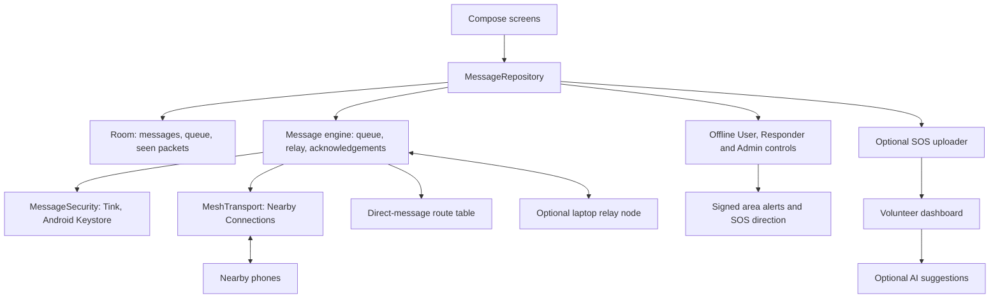
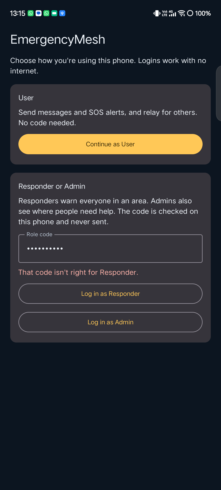
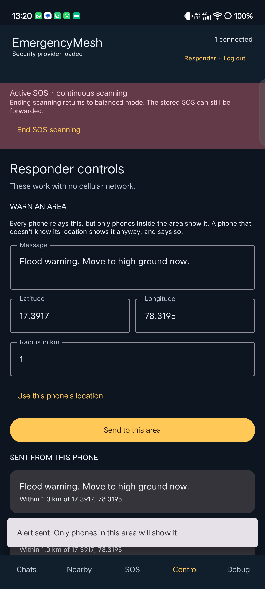
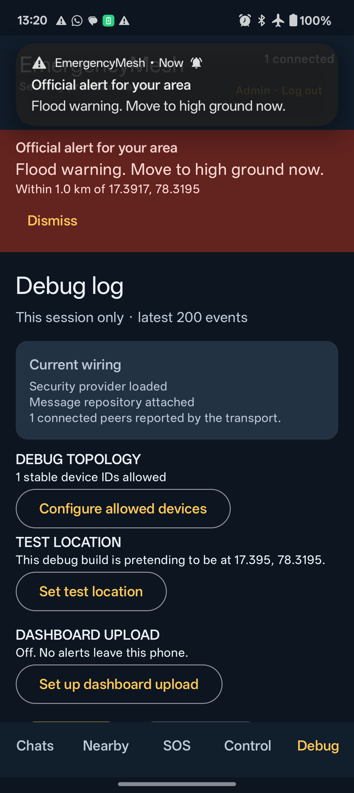
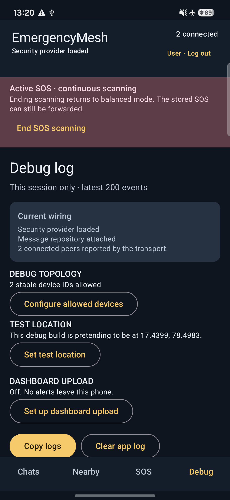
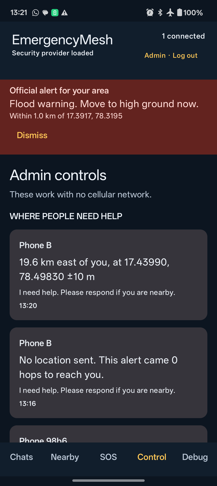

# EmergencyMesh

Offline emergency text messaging for Android. Nearby phones connect directly and carry messages for each other when cellular networks and internet are unavailable.

> **Project status:** working prototype, tested on three real Android phones. Real-phone results are in the [test matrix](docs/TEST_MATRIX.md). Features aren't claimed until they pass there.

---

## Team Information

| Attribute | Details |
| :--- | :--- |
| **Team Name** | **Slackers** |
| **Team Number** | `TEAM-30` (`HFT26-TEAM-30`) |
| **Registration ID** | `HFEST26-DU3LP6NK` |
| **Problem Track** | **Offline Emergency Messaging System** |
| **Domain** | `General Track` |
| **Team Leader** | Shrenik Singirikonda (shreniksin006@gmail.com) |
| **Institution** | CBIT Hyderabad |

### Team Members

| # | Name | Email | Institution |
| :--- | :--- | :--- | :--- |
| 1 | Saanvi Ponagoti | saanviraop@gmail.com | CBIT Hyderabad |
| 2 | Vindya Yelisetty | vindya975@gmail.com | CBIT Hyderabad |
| 3 | Sai Vishlesh Samala | saivishlesh2305@gmail.com | CBIT Hyderabad |
| 4 | Vangmay Puppireddy | vangmaipuppireddy8514@gmail.com | CBIT Hyderabad |

---

## Problem

During disasters, power cuts or network failures, conventional communication can become unavailable. People still need to reach family, friends and responders. The goal is a network-independent messaging system that works through nearby phones, prioritizes emergencies, shows honest delivery status, limits battery use and protects messages.

## Approach

1. Phones find each other and connect directly with Google Nearby Connections.
2. A message is saved on the sender's phone before any send attempt.
3. Phones carry messages toward the recipient through other phones.
4. SOS and emergency messages go ahead of regular messages.
5. Status comes from real acknowledgements, never from a guess.
6. If there's no path, the message stays Pending until a phone comes in range.
7. A foreground keep-alive can continue the mesh while the screen is locked, subject to phone-brand battery controls.
8. Optional rescue tools add Call-Out, Talk-Back, Last Breath and clearly labelled unverified no-app SOS intake.
9. An optional laptop node can store and carry encrypted packets, and a dashboard can receive explicitly enabled SOS uploads.
10. The dashboard can add AI-assisted triage and translation, while keeping the original alert visible and continuing to work with AI off.
11. User, Responder and Admin roles can be unlocked offline. Responders sign an area alert, which every phone relays; only phones inside the area display it when location is known.
12. The Admin control screen shows each SOS location as distance and direction from the admin's phone without maps or internet.
13. Direct messages learn a route from verified traffic and try the fewest-hop path first. Other paths open after an eight-second wait if delivery does not complete; SOS and area alerts continue to flood.

## Architecture



| Layer | Package | Responsibility |
| --- | --- | --- |
| Shared contracts | `core` | Packet format, interfaces and contact exchange |
| Radio | `transport` | Discovery, pairing, reconnect and immediate-neighbor packets |
| Storage and engine | `data`, `engine` | Persistent queue, relay, duplicates and acknowledgements |
| Security | `security` | Encryption, signatures and key storage |
| App | `ui` | Screens, permissions and status |
| Background runtime | `app`, `transport` | Foreground service and phone-brand keep-alive controls |
| Rescue extras | `core`, `engine`, `ui` | Call-Out, Talk-Back, Last Breath and no-app SOS intake |
| Laptop node and dashboard | `src/dashboard` | Optional packet custody, SOS display and AI-assisted review |
| Roles and area alerts | `security`, `core`, `ui` | Offline role checks, signed area alerts, admin SOS distance and direction |
| Routing | `engine` | Fewest-hop route for direct messages, with a flood fallback |

See [the contracts](docs/CONTRACTS.md) for packet rules and status meanings.

## Tech Stack

- Kotlin and Jetpack Compose
- Room
- Google Nearby Connections, `P2P_CLUSTER`
- Google Tink and the Android Keystore
- JUnit and AndroidX Test
- Android foreground services and notifications
- Python 3 standard library dashboard and laptop relay service
- Optional Featherless-hosted model for triage, extraction and translation

## Setup

**Requirements:** physical Android 8.0+ phones with Google Play services. Emulators can't test phone-to-phone radio.

**Fastest way:** download the [final APK](https://github.com/shrenik111/HFT26-TEAM-30/releases/tag/v0.1.0) and install it on each phone.

**To build it yourself,** you also need Android Studio:

1. Clone the repository.

```bash
git clone https://github.com/shrenik111/HFT26-TEAM-30.git
```

2. Open the `src/android` folder in Android Studio, and wait for Gradle sync.
3. Turn on USB debugging on each phone, then install the app.

```bash
cd HFT26-TEAM-30/src/android
```

```bash
./gradlew installDebug
```

4. Allow the requested nearby permissions.

The optional dashboard and laptop node have their own [setup guide](src/dashboard/README.md).

## Using the App

Do these once on each phone:

1. Tap **Continue as User**, then allow the permissions.
2. Open **Nearby**, name the phone, and tap **Start discovery**.
3. When two phones connect, check that both show the same token. Tick the box and tap **Accept**.
4. Phones swap contact cards automatically. If one doesn't appear in **Chats**, use **Enroll a contact**.
5. In **Chats**, tap **Inspect keys**, compare the fingerprint with the other phone, tick the box and tap **Mark verified**. Direct messages stay off until a contact is verified.
6. In **SOS**, tap **Set SOS group code** and enter the same long code on every phone.

Then try the features:

| Feature | Steps |
| --- | --- |
| Direct message | **Chats**, **Open chat**, type a message, **Queue message** |
| SOS | **SOS**, tick **Attach a recent location if available**, **Review and send SOS**, **Send SOS** |
| Relay through a middle phone | Debug builds: **Debug**, **Configure allowed devices**, so that A and C can each reach only B |
| Test location indoors | Debug builds: **Debug**, **Set test location** |
| Area alert | Log in as Responder or Admin, then **Control**, **Send to this area** |
| Where people need help | Log in as Admin, then open **Control** |

Role codes for Responder and Admin aren't in this repository. Ask the team for them.

## Tests

Run these from `src/android`.

```bash
./gradlew testDebugUnitTest
```

Device tests run on a connected phone. This command uninstalls the app afterwards, which removes its local data.

```bash
./gradlew connectedDebugAndroidTest
```

Android keeps tests with the app code:

| Tests | Location |
| --- | --- |
| Unit tests | `src/android/app/src/test` |
| Device tests | `src/android/app/src/androidTest` |

Manual radio steps are in [the transport test guide](docs/TRANSPORT_TEST.md).

## Demo Topology

The demo forces A to reach C only through B, using a debug allowlist:

```text
Phone A <----> Phone B <----> Phone C
   |                             |
   +--------- blocked -----------+
```

## Limitations

- Delivery needs a chain of nearby phones running the app, immediately or later on.
- Without a future path, a message stays Pending and can't be delivered.
- Background keep-alive depends on the phone brand and its battery settings. It passed while locked on Samsung, passed on vivo after setup, and failed on the tested OnePlus because the OS froze the app.
- Range hasn't been measured, and there are no unlimited-range claims.
- This doesn't replace official emergency services.
- This build is Android-only and needs Google Play services.
- SOS is readable by phones holding the group code, so it isn't open to every nearby person.
- This is a hackathon prototype, not a production disaster network, and it has had no independent security review.
- The laptop node and dashboard passed through a USB-backed test path; real phone-to-laptop Wi-Fi is still untested.
- The dashboard ran with AI off because no real model key was available, so no AI accuracy is claimed.
- Offline logins and area alerts were tested using debug test locations indoors. Real GPS area boundaries were not tested.
- Shortest routes were tested on three real phones and five simulated phones, not 1,000. The first message to a new phone still spreads through all paths. In balanced mode a phone stops looking for new phones once it has 3 links, which should limit connections in a crowd, but that wasn't tested at scale.
- Role codes in this prototype are short and shared by everyone in a role, and the matching public keys are in this public repository. A short code could be guessed offline, which would let someone forge official alerts. Real use needs long random codes and a way to remove one person.
- An SOS includes a location only when its phone has a fix from the previous two minutes; otherwise the admin sees that no location was sent.

The [mentor-changes phone test](docs/evidence/mentor-fixes.md) records the role, area, admin location and routing results and their limits. The [security review](docs/evidence/security-review.md) ties each security claim to the build that tested it.

## Demo Video

**Demo video:** [ADD FINAL VIDEO LINK HERE]

## Screenshots

Real-phone evidence is in [docs/evidence](docs/evidence).

| Evidence screenshot | What it shows |
| --- | --- |
|  | Phone A in the forced A-B-C topology |
|  | Phone B acting as the middle relay |
|  | Phone C with the direct A-C link blocked |
|  | Login screen refusing a wrong role code |
|  | Responder sending an area alert |
|  | Phone inside the area showing the alert |
|  | Phone outside the area, showing nothing after relaying the alert |
|  | Admin seeing an SOS as a distance and direction |

The last four screenshots use debug test locations. Measured delivery and mentor-change results are in the linked evidence reports.

## Attribution

Open-source and third-party components used:

| Component | Use | License |
| --- | --- | --- |
| [Google Tink](https://github.com/tink-crypto/tink-java) | Encryption and signatures | Apache 2.0 |
| [AndroidX, Jetpack Compose and Room](https://developer.android.com/jetpack) | App framework and storage | Apache 2.0 |
| [Kotlin and kotlinx.coroutines](https://github.com/Kotlin/kotlinx.coroutines) | Language and concurrency | Apache 2.0 |
| [JUnit 4](https://junit.org/junit4/) | Tests | EPL 1.0 |
| [Google Play services Nearby](https://developers.google.com/nearby/connections/overview) | Phone-to-phone connections | Google Play services terms |
| [Featherless](https://featherless.ai), default model `sarvamai/sarvam-m` | Optional hosted AI for the dashboard | Featherless terms and the model's license |

## License

This project is available under the [MIT License](LICENSE).
