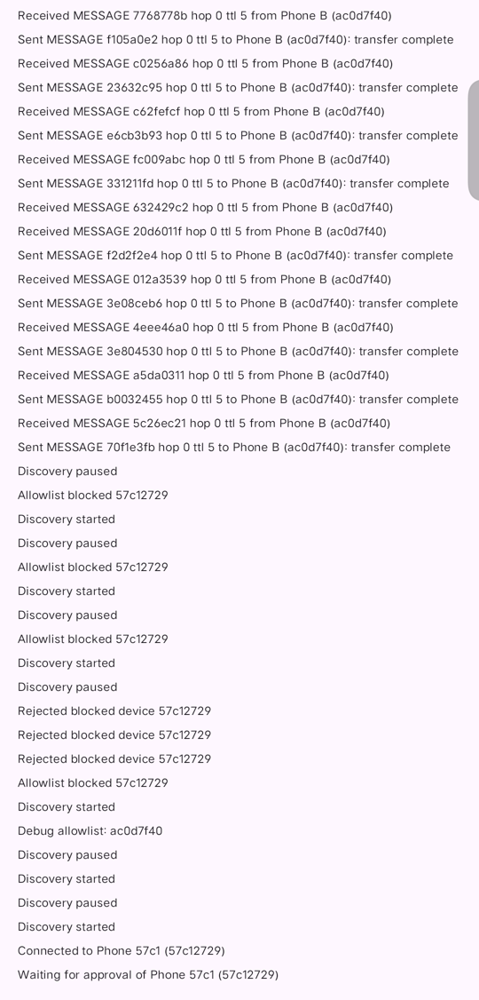
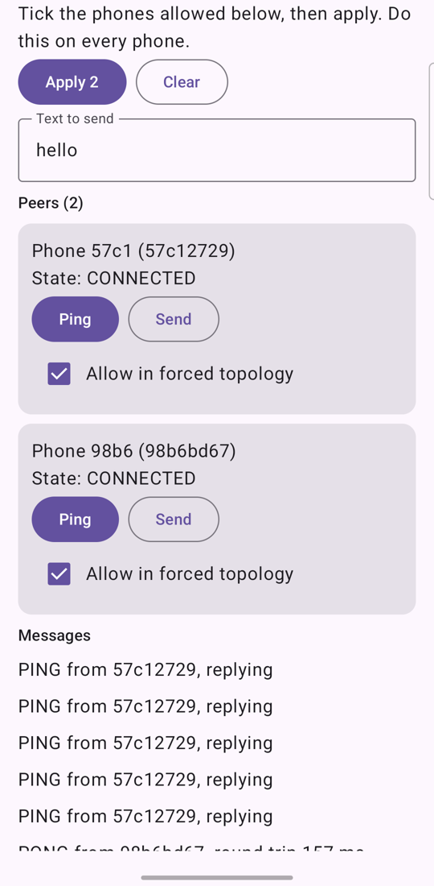
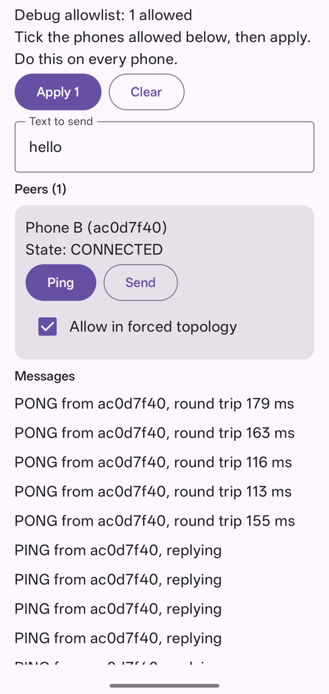

# [SUBMISSION] TEAM-30 - Slackers - Offline Emergency Messaging System

## Overview

EmergencyMesh is an Android prototype for messages and SOS alerts when cellular service and internet are unavailable. Nearby phones can carry encrypted packets to a recipient, and the sender sees a delivery timeline. The app retains an undelivered message through a restart and retries after the mesh reconnects.

## Architecture

- Kotlin and Jetpack Compose provide the interface; Room stores messages and retry state.
- Google Nearby Connections discovers peers. An intermediate phone forwards a packet and returns a delivery acknowledgement.
- Direct messages learn a route from verified traffic and try the fewest-hop path first, with an eight-second flood fallback. SOS and signed area alerts continue to flood.
- User, Responder and Admin controls work offline. A responder can send an area alert; an admin sees an SOS's distance and direction if it includes a recent location.
- Google Tink and Android Keystore protect content and identity. See [security evidence](evidence/tink-security.md) and the [two-phone encrypted messaging test](evidence/encrypted-messaging.md).
- Optional tools include foreground relay, Call-Out and Talk-Back, a low-battery SOS, Bluetooth-name SOS intake, a laptop node and an SOS dashboard. Dashboard AI was disabled during the phone test.

## Setup and demo

Open `src/android` in Android Studio, let Gradle sync, and install the debug app on Android phones with Bluetooth enabled. Pair and approve the devices. For offline relay, enable airplane mode and Bluetooth, turn off Wi-Fi, and place A, B and C so A cannot reach C directly. Send from A to C through B. The Debug tab's allowlist can enforce the A–B–C topology. See the [demo script](DEMO_SCRIPT.md).

The optional dashboard has [setup instructions](../src/dashboard/README.md). Never put keys, group codes, role codes or tokens in the PR.

## Evidence

- [Final offline three-phone build](evidence/final-build.md): vivo V2404, Samsung SM-S721B and OnePlus CPH2569; one-hop delivery in 2.6 seconds; four-stage timeline; no app crash lines in that run.
- [Required features](evidence/required-features.md): SOS ahead of 20 regular messages, Pending survives restart, one arrival per message ID.
- [Extras phone test](evidence/extras-phone-test.md): locked Samsung relay passed and vivo passed after a background setting change; OnePlus froze while locked. Laptop and dashboard used a USB bridge; AI was off.
- [Security review](evidence/security-review.md): each security claim tied to the build that tested it, including a relay phone holding no readable text on the final build.
- [Mentor changes phone test](evidence/mentor-fixes.md): offline roles; area alert crossed an outside relay and reached the inside phone in 3.0 seconds; locked Samsung inside was notified in 2.1 seconds; direct messages preferred a direct triangle link and used the relay after it disappeared.
- [Test matrix](TEST_MATRIX.md), [six-slide presentation](TEAM30_SUBMISSION.pptx) and its [editable outline](SLIDES.md).

### Screenshots

| Phone | Evidence screenshot |
| --- | --- |
| vivo A |  |
| Samsung B |  |
| OnePlus C |  |

Add final APK screenshots only after they are captured and checked.

### Demo video

**[ADD FINAL PUBLIC VIDEO LINK AFTER RECORDING THE FINAL APK]**

## Limits

Delivery requires available nearby phones. Locked relay depends on brand and battery policy. Battery drain and physical range have not been measured in the cited evidence. The extras run was not fully offline because A stayed on an internet hotspot; the core final-build test was fully offline. Real laptop Wi-Fi and a real phone without the app were not tested. A live AI model was not evaluated.

Mentor changes used indoor debug test locations, not real GPS boundaries. A phone without location displays an area alert rather than hiding it. An SOS carries a location only if its phone has a fix from the last two minutes. Routing was checked on three real phones and five simulated phones, not 1,000; an initial message to a new peer still spreads through all paths.

SOS is readable by phones holding the group code. There has been no independent security review and no forward secrecy.

## Submission check

Before opening this PR, confirm the target repository and branch, mandatory files, and demo-video length with the 2026 organizers. The public event pages checked on 31 October did not specify those details; do not infer a limit from another hackathon's rules.
